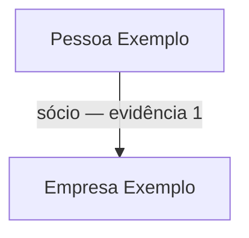

<Note>
**Em breve.** Contrato proposto, ainda indisponível para clientes. Os exemplos são simulações com dados fictícios. Rotas, limites, fontes, cobrança e cobertura dependem de implementação e publicação.
</Note>

O produto pretende reunir pessoas e empresas de um lote de CPFs/CNPJs em um grafo com evidências e datas. Ele ajuda a entender vínculos, controle societário e elementos compartilhados sem perder a origem de cada conexão.

**Rota proposta:** `POST /inteligencia/conexoes/pesquisar`.

## Entrada proposta

```json
{
  "documentos": [{"tipo":"CPF","valor":"<CPF>"},{"tipo":"CNPJ","valor":"<CNPJ>"}],
  "profundidade": 1,
  "incluir": ["sociedades", "enderecos_compartilhados"]
}
```

Documentos são marcadores de integração. Limite de lote, profundidade e tipos aceitos ainda serão fechados.

## Saída proposta

```json
{
  "entidades": [
    {"id":"pessoa_1","tipo":"pessoa","nome":"Pessoa Exemplo"},
    {"id":"empresa_1","tipo":"empresa","nome":"Empresa Exemplo"}
  ],
  "relacoes": [{"id":"relacao_1","origem":"pessoa_1","destino":"empresa_1","tipo":"socio","evidencias":["evidencia_1"]}],
  "evidencias": [{"id":"evidencia_1","fonte":"Fonte Societária Exemplo","consultado_em":"2026-10-13T12:00:00Z","vigencia_inicio":null,"vigencia_fim":null,"descricao":"Vínculo societário informado pela fonte."}],
  "cobertura": [{"fonte":"Fonte Societária Exemplo","status":"consultada"}],
  "resumo": "Uma relação societária informada pela fonte no exemplo.",
  "visual": {"grafo":{"nos":["pessoa_1","empresa_1"],"arestas":["relacao_1"]},"mapa":null},
  "incertezas": ["Data de consulta não confirma início ou fim do vínculo."]
}
```

Todos os IDs do grafo resolvem para entidades e relações no mesmo resultado. Fonte e datas acompanham a aresta. Telefone ou endereço compartilhado deve ter seu próprio tipo de vínculo; não pode se transformar em sociedade ou controle empresarial.

## Exemplo visual



A organização visual deve seguir o significado e a direção das relações, incluindo hierarquia societária. A posição do alvo não deve distorcer essa hierarquia.

## Uso atual e limites

O [Dossiê](/plataforma/dossie) já organiza relações da investigação. As APIs cadastrais mantêm suas consultas. Nenhuma delas constitui automaticamente o novo endpoint público em lote.

## Cobrança e cobertura

Preço, orçamento por fonte e limites de expansão ainda não definidos. Cobertura parcial e fontes sem resultado precisam ser explícitas. Um mapa só pode usar lugares que tenham localização e origem informadas.
