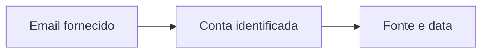

<Note>
**Em breve.** Contrato proposto, ainda indisponível para clientes. Os exemplos são simulações com dados fictícios. Rotas, limites, fontes, cobrança e cobertura dependem de implementação e publicação.
</Note>

O produto pretende reunir contas e cadastros associados a identificadores em uma pesquisa com cobertura por fonte. Ajuda a organizar uma presença digital e escolher contatos ou perfis para verificar.

**Rota proposta:** `POST /inteligencia/contas/pesquisar`.

## Entrada proposta

```json
{
  "emails": ["pessoa@example.org"],
  "telefones": ["5511999990000"],
  "documentos": [{"tipo":"CPF","valor":"<CPF>"}]
}
```

Pelo menos um conjunto precisa conter entrada. O marcador de documento deve ser substituído pelo consumidor; tamanho do lote e tipos aceitos por fonte ainda serão definidos.

## Saída proposta

```json
{
  "contas": [{
    "id": "conta_1",
    "plataforma": "Plataforma Exemplo",
    "tipo": "digital",
    "username": "perfil_exemplo",
    "nome": "Pessoa Exemplo",
    "url": "https://example.org/perfil",
    "foto": null,
    "identificadores": ["pessoa@example.org"],
    "origens": [{"fonte":"Fonte Exemplo","consultado_em":"2026-10-13T12:00:00Z"}]
  }],
  "vinculo_entre_identificadores": "fornecido_pelo_consumidor",
  "incertezas": ["A fonte reconhece a conta, mas não confirma identidade civil."]
}
```

## Exemplo visual



Mostre uma lista por plataforma com o identificador encontrado e sua origem. Um campo de foto ausente não autoriza gerar uma foto da pessoa.

## Uso atual e limites

Hoje existem `GET /registro/email/{email}`, `GET /registro/telefone/{telefone}` e `GET /registro/cpf/{cpf}`. O [Rastro](/plataforma/rastro) também pesquisa identificadores individualmente. Essas rotas continuam com seus próprios contratos; o lote agregado sob `/inteligencia` é novo planejamento.

## Cobrança e cobertura

Tarifa do novo produto não definida. Cobertura depende de cada identificador e fonte; contas sem correspondência, fontes indisponíveis e identificadores ainda não verificados devem ser separados. A deduplicação e o critério de vínculo entre contas precisam ser fechados antes da entrega.
