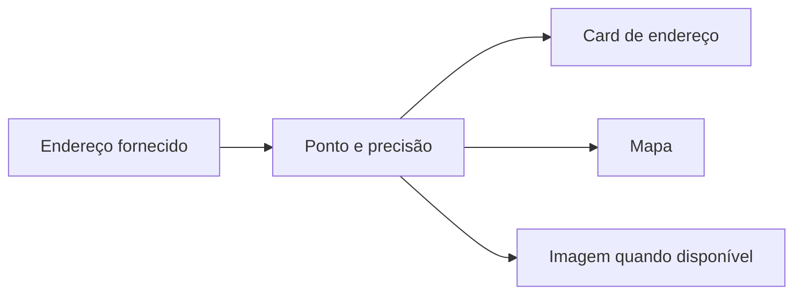

<Note>
**Em breve.** Contrato proposto, ainda indisponível para clientes. Os exemplos são simulações com dados fictícios. Rotas, limites, fontes, cobrança e cobertura dependem de implementação e publicação.
</Note>

O produto pretende transformar um endereço em localização, panorama externo, mapa e informações disponíveis sobre o lugar. Uma pesquisa adicional poderá trazer dados de prédio ou condomínio e estimativas imobiliárias quando houver fontes adequadas.

**Rota proposta:** `POST /inteligencia/enderecos/pesquisar`.

## Entrada proposta

```json
{
  "endereco": "Rua Exemplo, 123, Cidade Exemplo, SP",
  "complemento": "apto 1",
  "incluir": ["localizacao", "imagens", "perfil_imobiliario"]
}
```

O endereço é fictício. O contrato proposto recebe texto ou campos, sem exigir `geo_id`. Complemento fornecido pelo consumidor não se torna unidade confirmada pelo geocoder.

## Saída proposta

```json
{
  "id": "local_1",
  "status": "encontrado",
  "endereco": {"normalizado":"Rua Exemplo, 123, Cidade Exemplo, SP","complemento":"apto 1"},
  "ponto": {"lat":-23.5,"lng":-46.6},
  "precisao": "ROOFTOP",
  "local": {"nome":null,"tipo":null},
  "fachada": {"status":"indisponivel","url":null,"capturado_em":null,"credito":null},
  "mapa": {
    "type": "FeatureCollection",
    "features": [{"type":"Feature","id":"local_1","geometry":{"type":"Point","coordinates":[-46.6,-23.5]},"properties":{"rotulo":"Endereço Exemplo"}}]
  },
  "perfil_imobiliario": {
    "aluguel": null,
    "compra": null,
    "condominio": null,
    "status": "sem_evidencia_suficiente"
  },
  "fontes": [{"nome":"Fonte Geográfica Exemplo","consultado_em":"2026-10-13T12:00:00Z"}],
  "incertezas": ["A localização não confirma a unidade ou ocupação atual."]
}
```

GeoJSON usa `[longitude, latitude]`. Imagem pode estar ausente mesmo com endereço encontrado. Se houver estimativa de aluguel, compra ou condomínio, cada uma deverá informar faixa, moeda, origem, data e fatores; ausência permanece nula, sem inventar valores.

## Exemplo visual



## Base técnica e limites

Há implementação técnica de `POST /api/v1/enderecos/pesquisar` para normalização, geocodificação, panorama e mapa. Ela não libera automaticamente o produto sob `/inteligencia` nem entrega estimativas de aluguel, compra ou condomínio. A vitrine continua **Em breve**.

Um panorama externo próximo não comprova a fachada, a unidade ou o condomínio. Nome e tipo de local podem não estar disponíveis. Resultados ambíguos devem apresentar candidatos sem escolher um lugar por conta própria.

## Cobrança e cobertura

A tarifa do produto Inteligência ainda não está fechada. A cobertura financeira dependerá de fontes e data; identificar um prédio não garante encontrar valor de condomínio. Nenhum preço ou prazo comercial novo está definido.
