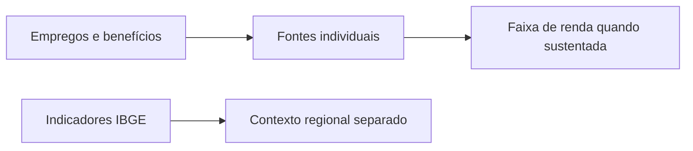

<Note>
**Em breve.** Contrato proposto, ainda indisponível para clientes. Exemplos com dados fictícios. Cobrança, fontes, limites e cobertura serão definidos antes da publicação.
</Note>

Veja quais fontes sustentam a leitura econômica de uma pessoa. O produto pretende reunir empregos, benefícios e faixas de renda quando houver evidência suficiente, distinguindo dados individuais de indicadores regionais.

**Ferramenta proposta:** perfil combinado, `POST /inteligencia/perfil/analisar`. A resposta desse perfil separa os blocos `financeira` e `patrimonial`; consultar as duas áreas não mistura seus totais.

## Entrada proposta

```json
{
  "cpf": "<CPF>",
  "areas": ["financeira"],
  "incluir": ["empregos", "beneficios", "contexto_ibge"]
}
```

## Saída proposta

```json
{
  "financeira": {
    "renda": {"faixa":null,"moeda":"BRL","periodo":null,"status":"sem_fontes_suficientes"},
    "empregos": [{"id":"emprego_1","empresa":"Empresa Exemplo","inicio":null,"fim":null,"salario":null,"fonte":"Fonte Trabalhista Exemplo","consultado_em":"2026-10-13T12:00:00Z"}],
    "beneficios": [],
    "contexto_ibge": {"nivel":"municipio","referencia":null,"rendimento_medio_regional":null,"status":"nao_consultado","renda_individual_inferida":false},
    "incertezas": ["Vínculo cadastral não informa salário nem confirma emprego atual."]
  },
  "patrimonial": null,
  "cobertura": [{"fonte":"Fonte Trabalhista Exemplo","status":"consultada"},{"fonte":"IBGE","status":"nao_consultada"}]
}
```

## Exemplo visual



Um emprego ou benefício não informa automaticamente renda total. Média de renda regional não é salário individual. A proposta não classifica uma pessoa pela aparência do imóvel ou pelo bairro.

Para bens e valores, veja [Patrimonial](/inteligencia/patrimonial). O [perfil combinado](/inteligencia/perfil) detalha a coleta conjunta e suas evidências.

## Cobrança e cobertura

Tarifa e fontes ainda não definidas. Renda permanece nula sem base suficiente. Valores devem ter fonte, período, natureza e incerteza; fontes indisponíveis precisam ser informadas.
