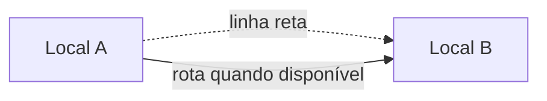

<Note>
**Em breve.** Contrato proposto, ainda indisponível para clientes. Os exemplos são simulações com dados fictícios. Rotas, limites, fontes, cobrança e cobertura dependem de implementação e publicação.
</Note>

O produto pretende comparar lugares fornecidos pelo consumidor, preservando precisão e fontes. Ele reúne operações matemáticas e trajetos em uma saída que pode alimentar ranking, mapa e comparação de distâncias.

**Rota proposta:** `POST /inteligencia/locais/comparar`.

## Entrada proposta

```json
{
  "pontos": [
    {"id":"local_a","rotulo":"Origem Exemplo","latitude":-23.5,"longitude":-46.6},
    {"id":"local_b","rotulo":"Destino Exemplo","latitude":-23.51,"longitude":-46.61}
  ],
  "operacoes": ["distancia_reta", "proximos", "rota", "mapa"],
  "origem": "local_a",
  "destino": "local_b",
  "raio_metros": 2000,
  "modo": "carro"
}
```

Coordenadas são fictícias e válidas. Também se propõe aceitar endereços para localização prévia. IDs de origem e destino precisam estar em `pontos`.

## Saída proposta

```json
{
  "pontos": [
    {"id":"local_a","latitude":-23.5,"longitude":-46.6,"precisao":"fornecida"},
    {"id":"local_b","latitude":-23.51,"longitude":-46.61,"precisao":"fornecida"}
  ],
  "distancias": [{"origem":"local_a","destino":"local_b","tipo":"reta","metros":1508.7}],
  "proximos": [{"id":"local_b","metros":1508.7}],
  "rota": {"status":"indisponivel","metros":null,"segundos":null,"geometria":null},
  "mapa": {"type":"FeatureCollection","features":[
    {"type":"Feature","id":"local_a","geometry":{"type":"Point","coordinates":[-46.6,-23.5]},"properties":{"rotulo":"Origem Exemplo"}},
    {"type":"Feature","id":"local_b","geometry":{"type":"Point","coordinates":[-46.61,-23.51]},"properties":{"rotulo":"Destino Exemplo"}},
    {"type":"Feature","id":"linha_reta_1","geometry":{"type":"LineString","coordinates":[[-46.6,-23.5],[-46.61,-23.51]]},"properties":{"tipo":"reta","origem":"local_a","destino":"local_b"}}
  ]},
  "incertezas": ["Não há rota disponível; a linha representada é distância reta, sem tempo de viagem."]
}
```

O exemplo arredonda uma distância esférica calculada entre os dois pontos. GeoJSON usa `[longitude, latitude]`. Reta não é trajeto e não informa duração. Um resultado de rota deverá trazer geometria, provedor, perfil, distância e tempo reais.

## Operações previstas

| Operação | O que resolve |
| --- | --- |
| Localização | Endereço → ponto com precisão |
| Distância reta | Separação entre duas coordenadas |
| Próximos | Ranking entre candidatos fornecidos, com raio opcional |
| Comparação | Matriz e grupos de pontos |
| Endereços compartilhados | Igualdade textual normalizada, com critério explícito |
| Trajeto | Caminho, distância e duração de um provedor |
| Mapa | Pontos e linhas declarativos |

## Exemplo visual



## Base técnica e limites

O motor do dossiê tem operações internas `geo_search`. Elas não implementam uma API pública sob `/inteligencia`. Buscar próximos entre pontos fornecidos não equivale a descobrir todos os estabelecimentos da região. Proximidade não comprova residência, emprego, propriedade ou vínculo.

## Cobrança e cobertura

Tarifa e limites públicos ainda não definidos. A pesquisa de endereço e o provedor de rota podem ter custos próprios; disponibilidade depende da fonte e região. O serviço deve preservar falhas parciais em vez de criar rotas ou tempos aproximados sem base.
