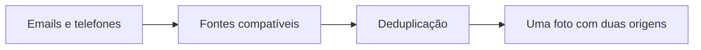

<Note>
**Em breve.** Contrato proposto, ainda indisponível para clientes. Os exemplos são simulações com dados fictícios. Rotas, limites, fontes, cobrança e cobertura dependem de implementação e publicação.
</Note>

O produto pretende reunir fotos encontradas para emails e telefones que o consumidor atribui à mesma pessoa. A lista permite revisar imagens sem perder as fontes que as associaram aos identificadores.

**Rota proposta:** `POST /inteligencia/imagens/pesquisar`.

## Entrada proposta

```json
{
  "emails": ["pessoa@example.org", "contato@example.org"],
  "telefones": ["5511999990000"]
}
```

Pelo menos um array deve conter entrada. O vínculo entre os identificadores é uma informação do consumidor, não uma identidade já confirmada pelo serviço.

## Saída proposta

```json
{
  "imagens": [{
    "url": "https://example.org/foto.png",
    "tem_rosto": true,
    "quantidade_rostos": 1,
    "origens": [
      {"fonte":"Fonte A","identificador":"pessoa@example.org","consultado_em":"2026-10-13T12:00:00Z"},
      {"fonte":"Fonte B","identificador":"5511999990000","consultado_em":"2026-10-13T12:00:01Z"}
    ]
  }]
}
```

`imagens[]` é uma lista ordenada. A mesma foto encontrada em várias fontes aparece uma vez com todas as `origens[]`. Sem foto, o resultado é `{"imagens":[]}`. O contrato não usa campos `melhor` ou `alternativas`.

Contagem de rosto depende de análise da imagem; a proposta deve distinguir análise indisponível de zero rostos. A definição de ordenação e deduplicação deve ser transparente. Rosto detectado não confirma identidade.

## Exemplo visual



## Uso atual e limites

[Registros digitais](/entidades/registro-digital) podem incluir `foto` conforme a fonte. Essa capacidade não implementa a agregação, ordenação ou contagem de rostos propostas aqui.

## Cobrança e cobertura

Tarifa, limite de identificadores, critérios de ranking, tratamento de imagens inacessíveis e retenção ainda precisam ser definidos. Sem promessa de foto para toda entrada. Uma resposta parcial deve informar fontes que não puderam ser consultadas.
