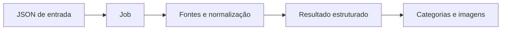

<Note>
**Em breve.** Contrato proposto, ainda indisponível para clientes. Os exemplos são simulações com dados fictícios. Rotas, limites, fontes, cobrança e cobertura dependem de implementação e publicação.
</Note>

Este é o desenho de integração dos quatro produtos propostos. Não envie requisições a estas rotas enquanto não houver uma versão publicada com contrato definitivo.

## Rotas propostas

| Produto | Criação de pesquisa proposta |
| --- | --- |
| Financeira | `POST /inteligencia/financeira/analisar` |
| Endereços | `POST /inteligencia/enderecos/pesquisar` |
| Redes sociais | `POST /inteligencia/redessociais/pesquisar` |
| Foto de perfil | `POST /inteligencia/imagens/pesquisar` |

As URLs propostas não contêm hífen. Entradas e saídas nas páginas dos produtos são propostas de estrutura e não schemas de uma API liberada. A Financeira recebe `cpf` ou `cnpj` e apenas `detalhamento` opcional (`resumido` ou `completo`): seleção de fontes é responsabilidade interna.

## Etapas de uma pesquisa assíncrona

1. Enviar a entrada JSON com autenticação Bearer e uma chave `Idempotency-Key`.
2. Receber **202** com ID da pesquisa, estado e intervalo sugerido de consulta.
3. Acompanhar o job na proposta `GET /inteligencia/pesquisas/{id}`.
4. Ler o resultado final junto de `cobertura`, `incertezas` e `cobranca`.

A rota de acompanhamento também é proposta. O processamento poderia começar em `fila`, passar por `processando` e terminar em `concluido`, `falhou` ou `cancelado`. A política de cancelamento, retenção e expiração ainda será definida.

Exemplo de aceitação:

```json
{
  "id": "pesquisa_exemplo_001",
  "status": "fila",
  "consultar_apos_segundos": 3,
  "cobranca": {"status":"nao_cobrado","valor":null,"unidade":null}
}
```

Exemplo de job concluído — `resultado` varia por produto:

```json
{
  "id": "pesquisa_exemplo_001",
  "status": "concluido",
  "parcial": false,
  "resultado": {"imagens":[]},
  "cobertura": [{"fonte":"Fonte Exemplo","status":"sem_correspondencia","consultado_em":"2026-10-13T12:00:00Z"}],
  "incertezas": [],
  "cobranca": {"status":"nao_cobrado","valor":null,"unidade":null}
}
```

Os JSONs nas páginas dos produtos mostram o conteúdo de `resultado`, sem repetir todo o envelope. Datas e valores são fictícios; os campos de cobrança nulos indicam que a tarifa não foi definida.

## Erro comum proposto

```json
{
  "id": "pesquisa_exemplo_001",
  "status": "falhou",
  "erro": {
    "codigo": "entrada_invalida",
    "mensagem": "Informe pelo menos um identificador válido.",
    "repetivel": false,
    "campos": ["emails", "telefones"]
  },
  "cobranca": {"status":"nao_cobrado","valor":null,"unidade":null}
}
```

Os códigos finais de HTTP, erro e cobrança serão fechados antes da publicação. Falha de uma fonte pode produzir job parcial; não deve ser convertida em “nada encontrado”.

## Fontes, visuais e revisão

Cada achado deve manter fonte e data quando disponíveis. Fotos repetidas acumulam suas origens; valores financeiros devem indicar referência, natureza e confiança. Endereços mantêm precisão e contexto separado da renda individual.



O visual apresenta o resultado estruturado; não cria vínculos, preços ou fatos que não foram coletados. Conteúdo sensível, imagens, URLs e retenção precisam de política definida por produto.

## Cobrança e cobertura

Nenhuma tarifa nova está fechada. Limites de lote, orçamento por fonte, cobrança de parcialidade, estorno, prazo de processamento e cobertura por região precisam ser definidos por produto. Consulte [Custos](/custos) somente para as APIs existentes.
