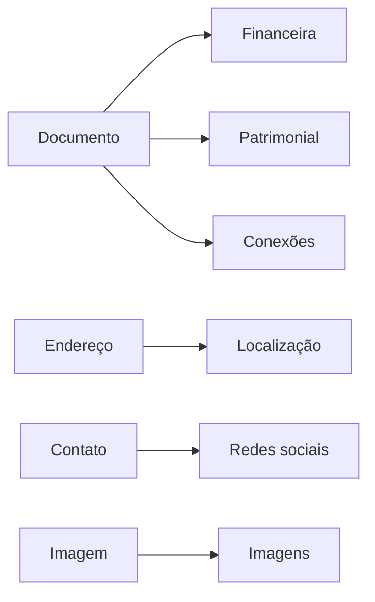

<Note>
**Em breve.** Contrato proposto, ainda indisponível para clientes. Exemplos com dados fictícios. Cobrança, fontes, limites e cobertura serão definidos antes da publicação.
</Note>

Parta de um contato, documento, endereço ou imagem e encontre a investigação que responde à sua pergunta. Cada produto pretende entregar achados estruturados, fontes e uma visão visual para orientar a próxima decisão.

<CardGroup cols={2}>
  <Card title="Financeira · Em breve" icon="chart-line" href="/inteligencia/financeira">Renda documentada, empregos, benefícios e contexto econômico regional.</Card>
  <Card title="Patrimonial · Em breve" icon="landmark" href="/inteligencia/patrimonial">Imóveis, escrituras, veículos, participações e referências de valor.</Card>
  <Card title="Localização · Em breve" icon="location-dot" href="/inteligencia/localizacao">Endereços, fachadas, mapas, trajetos e evolução do contexto residencial.</Card>
  <Card title="Redes sociais · Em breve" icon="users" href="/inteligencia/redessociais">Contas, perfis e imagens encontrados a partir de contatos.</Card>
  <Card title="Conexões · Em breve" icon="diagram-project" href="/inteligencia/conexoes">Pessoas e empresas em um grafo com evidência por relação.</Card>
  <Card title="Imagens · Em breve" icon="camera" href="/inteligencia/midia">Investigue lugar, correspondências e ocorrências a partir de uma imagem.</Card>
</CardGroup>

## De um dado a uma visão investigativa

As seis áreas agrupam oito ferramentas propostas: contas, imagens de perfil, endereços, veículos, conexões, comparação geoespacial, mídia inversa e perfil combinado. Cada ferramenta tem entrada, saída e exemplo visual. O perfil combinado mantém os resultados financeiros e patrimoniais separados.

Leia a [integração proposta](/inteligencia/integracao) para jobs, cobertura e erros. As novas rotas `/inteligencia` não estão disponíveis no playground. As APIs existentes de [Rastro](/plataforma/rastro), [Lente](/plataforma/lente), [Veículos](/entidades/veiculo), [Registros](/entidades/registro-digital) e [Dossiê](/plataforma/dossie) continuam com seus próprios contratos.

## Cobrança e cobertura

Os novos produtos não têm tarifa, SLA ou cobertura comercial fechados. Retorno vazio não prova ausência. Fonte indisponível, consulta sem correspondência e inferência devem aparecer separadamente, com origem e data quando houver.
