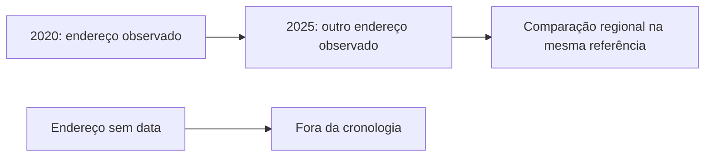

<Note>
**Em breve.** Contrato proposto, ainda indisponível para clientes. Exemplos com dados fictícios. Cobrança, fontes, limites e cobertura serão definidos antes da publicação.
</Note>

Localize endereços, compare lugares e veja como registros de localização se distribuem no tempo. O produto pretende unir precisão, fonte, imagem e contexto sem transformar uma observação cadastral em moradia confirmada.

**Ferramentas propostas:** [endereços](/inteligencia/enderecos), `POST /inteligencia/enderecos/pesquisar`, e [geoespacial](/inteligencia/geoespacial), `POST /inteligencia/locais/comparar`.

## Entrada proposta: histórico de endereços

```json
{
  "pontos": [
    {"id":"local_a","endereco":"Rua Exemplo A, 10, Cidade Exemplo, SP","observacao":{"data":"2020-06-01","natureza":"observacao_cadastral","fonte":"Fonte A"}},
    {"id":"local_b","endereco":"Rua Exemplo B, 20, Cidade Exemplo, SP","observacao":{"data":"2025-08-01","natureza":"observacao_cadastral","fonte":"Fonte B"}},
    {"id":"local_c","endereco":"Rua Exemplo C, 30, Cidade Exemplo, SP","observacao":{"data":null,"natureza":"observacao_cadastral","fonte":"Fonte C"}}
  ],
  "operacoes": ["mapa", "historico", "contexto_residencial"]
}
```

## Saída proposta: linha do tempo e contexto

```json
{
  "historico": {
    "status": "parcial",
    "eventos_datados": [
      {"local_id":"local_a","data":"2020-06-01","natureza_data":"observacao_cadastral","vigencia_residencia":null,"fonte":"Fonte A"},
      {"local_id":"local_b","data":"2025-08-01","natureza_data":"observacao_cadastral","vigencia_residencia":null,"fonte":"Fonte B"}
    ],
    "sem_data": [{"local_id":"local_c","data":null,"fonte":"Fonte C"}],
    "limitacoes": ["Datas de observação não confirmam início, fim ou existência de moradia.","Registro sem data não é ordenado na cronologia."]
  },
  "contexto_residencial": {
    "comparacoes": [{
      "origem": "local_a", "destino": "local_b",
      "natureza": "estimativa_regional",
      "referencia_comum": "2026-10",
      "base": "aluguel_mensal_imoveis_comparaveis",
      "geografia": "regioes_do_exemplo",
      "origem_faixa": {"minimo":2500,"maximo":3200},
      "destino_faixa": {"minimo":1500,"maximo":2200},
      "moeda": "BRL",
      "fontes": ["Base Imobiliária Exemplo"],
      "leitura": "Região do destino apresenta menor faixa de custo residencial na referência comum.",
      "impacto_patrimonio": "nao_inferido",
      "impacto_renda": "nao_inferido"
    }],
    "condominio": null,
    "compra": null
  },
  "incertezas": ["Valores fictícios; não são despesas individuais observadas nem prova de mudança de residência."]
}
```

O exemplo usa uma referência comum para comparar faixas regionais; não compara diretamente preços de 2020 com preços de 2025. Aluguel, compra e condomínio devem manter bases, data, geografia e critérios compatíveis. Sem comparabilidade, não deve existir conclusão de aumento ou queda de custo.

## Exemplo visual



Fonte com vigência residencial explícita pode informar esse intervalo. Data cadastral ou de consulta só prova quando a observação foi feita. Texto sobre mudança para região de menor custo residencial deve explicar essa limitação e não inferir queda de renda ou patrimônio.

## Cobrança e cobertura

Tarifa e fontes ainda não definidos. Histórico, imagens e custos imobiliários podem estar indisponíveis. A localização de um lugar não confirma sua propriedade, ocupação ou custo individual.

## Sem datas: endereços atuais mais plausíveis

Quando as fontes não trouxerem vigência de residência, a proposta poderá produzir um ranking de hipóteses sobre o endereço atual. Ele deve usar sinais explícitos de recência, frequência, concordância de fontes e tipo do local. Classificação como casa ou prédio residencial pode apoiar uma hipótese; prédio comercial ou endereço de empresa não é residência como fato.

Entrada proposta para a ferramenta geoespacial:

```json
{
  "pontos": [
    {"id":"local_a","endereco":"Rua Exemplo A, 10, Cidade Exemplo, SP","tipo_local":{"valor":"residencial","fonte":"Fonte Exemplo","confirmado":false},"vigencia_residencia":null,"evidencias":["evidencia_a"]},
    {"id":"local_b","endereco":"Rua Exemplo B, 20, Cidade Exemplo, SP","tipo_local":{"valor":"comercial","fonte":"Fonte Exemplo","confirmado":false},"vigencia_residencia":null,"evidencias":["evidencia_b"]}
  ],
  "operacoes": ["enderecos_atuais_plausiveis"]
}
```

Saída proposta:

```json
{
  "hipoteses_endereco_atual": [
    {"local_id":"local_a","plausibilidade":"moderada","motivos":["Fonte relaciona o endereço à pessoa.","Tipo residencial sugerido pela fonte."],"data_residencia":null},
    {"local_id":"local_b","plausibilidade":"baixa","motivos":["Fonte relaciona o endereço a uma empresa; uso residencial não confirmado."],"data_residencia":null}
  ],
  "evidencias": [
    {"id":"evidencia_a","fonte":"Fonte Exemplo","descricao":"Endereço associado, sem data de vigência."},
    {"id":"evidencia_b","fonte":"Fonte Exemplo","descricao":"Endereço comercial associado, sem data de vigência."}
  ],
  "sequencia_hipotetica": null,
  "alternativas": ["local_b"],
  "limitacoes": ["Ranking não confirma residência atual.","Não há sinais suficientes para ordenar mudanças de endereço.","Níveis qualitativos não são probabilidades estatísticas calibradas."]
}
```

Uma sequência hipotética só poderá ser apresentada quando houver sinais que sustentem sua ordem, com condições, motivos e alternativas explícitos. Ela não deve ganhar datas inventadas nem aparecer como histórico confirmado. O ranking de endereço atual e a cronologia de eventos são resultados distintos.
