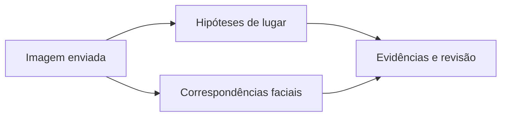

<Note>
**Em breve.** Contrato proposto, ainda indisponível para clientes. Os exemplos são simulações com dados fictícios. Rotas, limites, fontes, cobrança e cobertura dependem de implementação e publicação.
</Note>

O produto pretende partir de uma imagem para levantar hipóteses de lugar ou correspondências faciais, preservando fontes e confiança. A Lente é a base existente para essa análise; a nova embalagem pública permanece proposta.

**Rota proposta:** `POST /inteligencia/midia/pesquisar`.

## Entrada proposta

```json
{
  "modo": "localizacao",
  "arquivo": {
    "tipo": "image/jpeg",
    "tamanho_bytes": 12345,
    "sha256": "0000000000000000000000000000000000000000000000000000000000000000"
  }
}
```

Tamanho e hash são fictícios: devem ser calculados sobre o arquivo real. A proposta prevê modos de localização e facial com envio privado, instruções de upload e confirmação antes do processamento. Formatos e limite definitivo desse novo produto ainda serão definidos.

## Saída proposta

```json
{
  "modo": "localizacao",
  "hipoteses": [{
    "id": "hipotese_1",
    "local": "Região Exemplo",
    "ponto": null,
    "confianca": "baixa",
    "evidencias": ["evidencia_1"]
  }],
  "evidencias": [{"id":"evidencia_1","tipo":"pista_visual","descricao":"Elemento arquitetônico observado na imagem.","fonte":"Análise Visual Exemplo","consultado_em":"2026-10-13T12:00:00Z"}],
  "correspondencias": [],
  "incertezas": ["Pista visual não confirma a cidade nem uma coordenada."]
}
```

No modo facial, `correspondencias` poderá trazer origem, imagem e similaridade quando o provedor as informar. Pontuação não é identidade confirmada. Não se propõe um conjunto fixo de sites ou uma busca universal de todas as imagens da web.

## Exemplo visual



## Uso atual e limites

A [Lente](/plataforma/lente) existente usa `POST /lente/analyses`, modos `geo` e `face`, envio privado e `submit`. Seu contrato atual aceita JPEG, PNG e WebP de até 15 MiB. Essa regra pertence à Lente atual, não define automaticamente limites da proposta Inteligência.

Um agente adicional de pesquisa web é planejamento. Nenhum novo provedor ou integração é anunciado como disponível.

## Cobrança e cobertura

Sem tarifa ou cobertura comercial fechada para o novo produto. Qualidade da imagem, modo e disponibilidade de fontes influenciam os resultados. Política de acesso, retenção, URLs temporárias e revisão devem ser definida antes da publicação.
