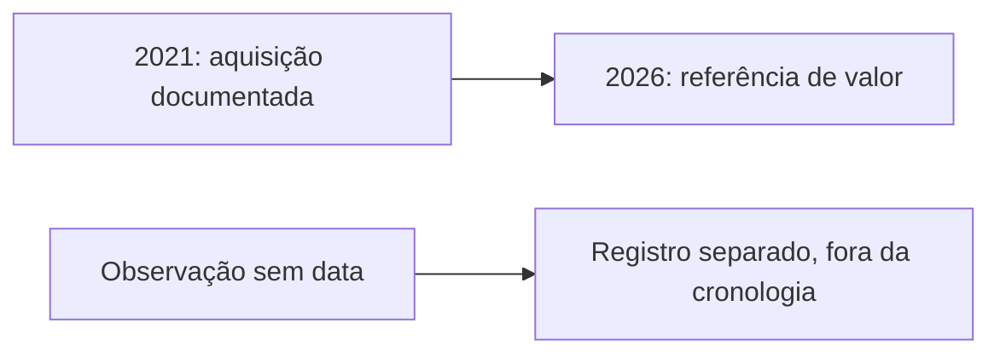

<Note>
**Em breve.** Produto e contrato propostos, ainda indisponíveis para clientes. Dados e valores abaixo são ilustrativos; não representam uma pessoa real. Critérios, cobrança e cobertura serão definidos antes da publicação.
</Note>

O patrimônio é um contexto complementar da API Financeira. Ele reúne bens atribuídos por fonte e referências de valor para revisão, mantendo renda e despesas residenciais em categorias próprias.

A pesquisa continua simples: um CPF, com detalhamento opcional. Não há necessidade de selecionar imóveis, escrituras, FIPE ou participações; a API abstrai essas fontes.

## Entrada proposta

```json
{
  "cpf": "<CPF>",
  "detalhamento": "completo"
}
```

## Resultado ilustrativo: patrimônio e evolução

```json
{
  "patrimonio": {
    "estimativa": {
      "faixa": {
        "minimo": 280000,
        "maximo": 380000
      },
      "moeda": "BRL",
      "referencia": "2026-10",
      "natureza": "estimativa_complementar",
      "compoe_renda": false,
      "metodo": "Exemplo de estimativa após revisão dos bens atribuídos e bases de valor."
    },
    "bens_atribuidos": [
      {
        "id": "imovel_1",
        "tipo": "imovel",
        "fonte": "Registro Exemplo",
        "valor_venal": {
          "valor": 200000,
          "moeda": "BRL",
          "referencia": "2025"
        },
        "mercado_estimado": {
          "faixa": {
            "minimo": 235000,
            "maximo": 335000
          },
          "moeda": "BRL",
          "referencia": "2026-10",
          "fonte": "Comparáveis Exemplo"
        }
      },
      {
        "id": "veiculo_1",
        "tipo": "veiculo",
        "fonte": "Cadastro Veicular Exemplo",
        "fipe": {
          "valor": 45000,
          "moeda": "BRL",
          "referencia": "2026-10",
          "fonte": "Referência FIPE Exemplo"
        }
      }
    ],
    "bens_nao_confirmados": [],
    "participacoes": [],
    "enderecos_residenciais_contados_como_bens": false,
    "evolucao": {
      "situacao": "parcial",
      "eventos_datados": [
        {
          "id": "evento_1",
          "bem_id": "imovel_1",
          "tipo": "aquisicao_informada",
          "data": "2021-05-10",
          "natureza_data": "data_do_ato",
          "fonte": "Documento Exemplo",
          "evidencia_id": "evidencia_1"
        }
      ],
      "eventos_sem_data": [
        {
          "id": "evento_2",
          "bem_id": "veiculo_1",
          "tipo": "observacao_cadastral",
          "data": null,
          "fonte": "Cadastro Exemplo",
          "evidencia_id": "evidencia_2"
        }
      ],
      "limitacoes": [
        "Sem documento de venda consultado; ausência não confirma manutenção de propriedade.",
        "Evento sem data fica fora da ordenação cronológica."
      ]
    }
  },
  "evidencias": [
    {
      "id": "evidencia_1",
      "fonte": "Documento Exemplo",
      "descricao": "Documento fictício atribui aquisição ao alvo.",
      "consultado_em": "2026-10-13T12:00:00Z"
    },
    {
      "id": "evidencia_2",
      "fonte": "Cadastro Exemplo",
      "descricao": "Observação fictícia sem data de vigência.",
      "consultado_em": "2026-10-13T12:00:00Z"
    }
  ],
  "incertezas": [
    "Valores ilustrativos; atribuição atual, dívidas e metodologia precisam de verificação."
  ]
}
```

O exemplo estima patrimônio com uma mesma referência de mercado para o imóvel e FIPE como referência complementar do veículo. Valor venal fiscal de 2025 permanece separado: não é somado de novo ao imóvel. Essa aproximação não comprova preço realizável nem patrimônio líquido; a metodologia deverá explicitar obrigações, dívidas e valores ausentes.

## Linha do tempo



Evolução patrimonial precisa de aquisição, venda ou transferência atribuída em documentos, escrituras, veículos ou participações. Endereço de residência não comprova propriedade. Bem de parente não é patrimônio do alvo.

Uma mudança para região de menor custo residencial, descrita em [Localização](/inteligencia/localizacao), não implica automaticamente queda de patrimônio ou renda.

<Accordion title="Como este detalhe integra a API Financeira">

**Rota proposta:** `POST /inteligencia/financeira/analisar`.

Este bloco será parte do detalhamento completo da mesma pesquisa. Leia [Financeira](/inteligencia/financeira) para o resultado consolidado e [Detalhamento financeiro](/inteligencia/perfil) para método, composição da renda e fontes.

</Accordion>

## Cobrança e cobertura

Preço e fontes ainda não definidos. Atribuição, datas e valores podem estar ausentes; a evolução deve informar essas lacunas. Patrimônio estimado não é salário nem receita de aluguel.
