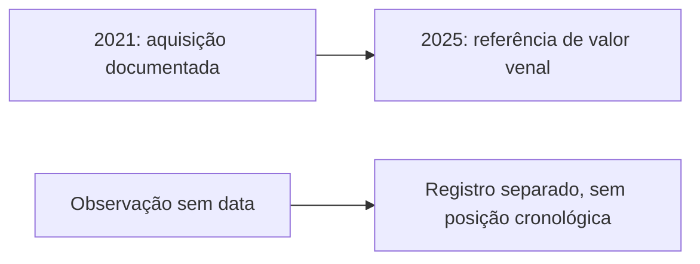

<Note>
**Em breve.** Contrato proposto, ainda indisponível para clientes. Exemplos com dados fictícios. Cobrança, fontes, limites e cobertura serão definidos antes da publicação.
</Note>

O produto pretende reunir imóveis, escrituras, veículos e participações com sua origem e referências de valor. A visão separa bens atribuídos por fonte, bens não confirmados e endereços candidatos para evitar somas sem base.

**Ferramentas propostas:** [perfil combinado](/inteligencia/perfil), `POST /inteligencia/perfil/analisar`, e [veículos](/inteligencia/veiculos), `POST /inteligencia/veiculos/pesquisar`.

## Entrada proposta

```json
{
  "cpf": "<CPF>",
  "areas": ["patrimonial"],
  "incluir": ["imoveis", "escrituras", "veiculos", "participacoes", "evolucao"]
}
```

## Saída proposta: bens e evolução

```json
{
  "financeira": null,
  "patrimonial": {
    "bens_atribuidos": [{"id":"imovel_1","tipo":"imovel","fonte":"Registro Exemplo","valor_venal":{"valor":200000,"moeda":"BRL","referencia":"2025"},"mercado":null}],
    "bens_nao_confirmados": [],
    "participacoes": [],
    "totais": {"valor_venal_atribuido":{"valor":200000,"moeda":"BRL","itens":["imovel_1"],"referencia":"2025"},"nao_confirmado":null,"patrimonio_total":null},
    "evolucao": {
      "status": "parcial",
      "eventos_datados": [{"id":"evento_1","bem_id":"imovel_1","tipo":"aquisicao_informada","data":"2021-05-10","natureza_data":"data_do_ato","fonte":"Documento Exemplo","evidencia_id":"evidencia_1"}],
      "eventos_sem_data": [{"id":"evento_2","bem_id":"imovel_1","tipo":"observacao_cadastral","data":null,"fonte":"Cadastro Exemplo","evidencia_id":"evidencia_2"}],
      "limitacoes": ["Sem documento de venda consultado; ausência não confirma manutenção de propriedade.","Evento sem data não participa da ordenação cronológica."]
    }
  },
  "evidencias": [
    {"id":"evidencia_1","fonte":"Documento Exemplo","descricao":"Documento atribui aquisição à pessoa do exemplo.","consultado_em":"2026-10-13T12:00:00Z"},
    {"id":"evidencia_2","fonte":"Cadastro Exemplo","descricao":"Observação sem data de vigência.","consultado_em":"2026-10-13T12:00:00Z"}
  ]
}
```

## Linha do tempo patrimonial



Evolução patrimonial real precisa de aquisição, venda ou transferência atribuída ao alvo em documentos, escrituras, registros de veículos ou participações. Um endereço residencial não é prova de propriedade e não entra no patrimônio.

Valor venal é fiscal; FIPE é referência de veículo; mercado é estimativa com faixa. Preserve base e data de cada valor. Não some categorias distintas como se formassem patrimônio líquido confirmado.

## Contexto residencial e limites

A [Localização](/inteligencia/localizacao) poderá mostrar mudanças de endereço e custo residencial regional com fontes e datas. “Mudança para região de menor custo residencial” pode descrever a comparação entre bases compatíveis. Isso não implica automaticamente queda de patrimônio ou renda.

## Cobrança e cobertura

Preço e fontes ainda não definidos. A evolução será parcial quando faltar data, vigência, atribuição ou documento. Sem valor suficiente, totais permanecem nulos e explicam a ausência; bens de parentes não são atribuídos automaticamente ao alvo.
