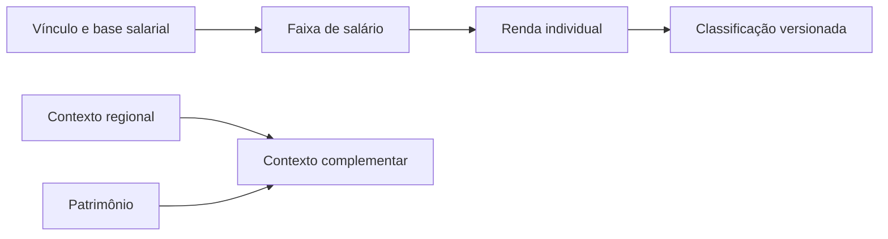

<Note>
**Em breve.** Produto e contrato propostos, ainda indisponíveis para clientes. Dados e valores abaixo são ilustrativos; não representam uma pessoa real. Critérios, cobrança e cobertura serão definidos antes da publicação.
</Note>

A API Financeira consolida métricas de renda, salário, localização, aluguel, patrimônio e benefícios a partir de um CPF ou CNPJ. Esta página detalha a mesma pesquisa, com explicações para revisão das estimativas.

## Entrada proposta

```json
{
  "cpf": "<CPF>",
  "detalhamento": "completo"
}
```

Não é necessário escolher fontes. A coleta poderá reunir vínculos profissionais, benefícios, endereços, contexto IBGE, aluguel, escrituras, FIPE e participações conforme disponibilidade. Esses insumos são abstraídos pelo produto.

## Como o resultado deve ser lido

| Métrica | Interpretação |
| --- | --- |
| Salário estimado | Faixa sustentada por vínculo profissional e base de remuneração compatível; vínculo sem remuneração não vira salário confirmado |
| Renda mensal/anual | Receitas individuais com natureza, período e evidência; sem somar estimativas redundantes |
| Classificação por renda | Critério documentado, versionado e calibrável, com confiança e incertezas |
| Contexto regional | Indicador do território; não é renda individual |
| Aluguel residencial | Estimativa de despesa/contexto; não é recebimento da pessoa |
| Patrimônio | Informação complementar sobre bens atribuídos por fonte; não renda mensal |
| Benefícios | Receita só quando valor, período e atribuição forem sustentados |

<Accordion title="Exemplo completo: método, composição e fontes">

**Rota proposta:** `POST /inteligencia/financeira/analisar`.

```json
{
  "renda_estimada": {
    "mensal": {
      "minimo": 4500,
      "maximo": 6500
    },
    "anual": {
      "minimo": 54000,
      "maximo": 78000
    },
    "moeda": "BRL",
    "base_anual_meses": 12,
    "componentes": [
      {
        "id": "receita_1",
        "tipo": "salario_estimado",
        "mensal": {
          "minimo": 4500,
          "maximo": 6500
        },
        "referencia": "2026-10",
        "evidencias": [
          "evidencia_1"
        ]
      }
    ],
    "itens_excluidos": [
      "Aluguel residencial estimado",
      "Patrimônio estimado",
      "Rendimento médio regional"
    ]
  },
  "classificacao_renda": {
    "faixa": "media",
    "confianca": "moderada",
    "metodo": {
      "nome": "faixas_ilustrativas_de_renda_mensal_individual",
      "versao": "proposta-0.1",
      "criterios_ilustrativos": [
        {
          "faixa": "baixa",
          "mensal_inferior": 0,
          "mensal_superior_exclusivo": 3000
        },
        {
          "faixa": "media",
          "mensal_inferior": 3000,
          "mensal_superior_exclusivo": 10000
        },
        {
          "faixa": "alta",
          "mensal_inferior": 10000,
          "mensal_superior_exclusivo": null
        }
      ],
      "base": "renda_mensal_individual_estimativa_bruta",
      "calibrado": false,
      "observacao": "Limiares fictícios para demonstrar a estrutura; não são classificação oficial ou critério liberado."
    },
    "motivos": [
      "Há vínculo profissional no exemplo e referência compatível de remuneração."
    ],
    "incertezas": [
      "Faixa estimada não confirma pagamento individual nem continuidade do vínculo."
    ]
  },
  "enderecos": [
    {
      "id": "endereco_1",
      "normalizado": "Rua Exemplo, 123, Cidade Exemplo, SP",
      "vinculo": "residencia_candidata",
      "vigencia_residencial": null,
      "contexto_regional": {
        "nivel": "municipio",
        "faixa": "media",
        "referencia": "2026-10",
        "fonte": "Indicadores Regionais Exemplo",
        "renda_individual_inferida": false
      },
      "aluguel_estimado": {
        "mensal": {
          "minimo": 1800,
          "maximo": 2400
        },
        "moeda": "BRL",
        "referencia": "2026-10",
        "fonte": "Comparáveis Residenciais Exemplo",
        "receita_da_pessoa": false
      }
    }
  ],
  "patrimonio_estimado": {
    "faixa": {
      "minimo": 280000,
      "maximo": 380000
    },
    "moeda": "BRL",
    "referencia": "2026-10",
    "natureza": "estimativa_complementar",
    "compoe_renda": false,
    "metodo": "Estimativa ilustrativa sobre bens atribuídos; atribuição, datas, dívidas e bases precisam de revisão."
  },
  "evidencias": [
    {
      "id": "evidencia_1",
      "fonte": "Vínculo Profissional e Referência Salarial Exemplo",
      "descricao": "Insumos fictícios compatíveis com a faixa estimada.",
      "referencia": "2026-10",
      "consultado_em": "2026-10-13T12:00:00Z"
    }
  ],
  "cobertura": [
    {
      "fonte": "Vínculos profissionais",
      "situacao": "consultada_no_exemplo"
    },
    {
      "fonte": "Benefícios",
      "situacao": "sem_valor_confirmado_no_exemplo"
    }
  ]
}
```

A renda anual multiplica a mensal por 12 neste exemplo. Pagamentos adicionais só poderão entrar quando houver fonte e regra de composição explícitas. O produto não deve confundir limite desconhecido com renda zero.

Se a faixa estimada atravessar os limiares de classificação, o método deverá representar essa incerteza. Confiança mede qualidade da evidência e do método; não é probabilidade calibrada sem validação específica.

</Accordion>

## Exemplo visual



Para CNPJ, a mesma API usa faturamento mensal/anual estimado e classificação de porte por método proposto. Não estima “salário da empresa” nem converte faturamento em lucro ou renda dos sócios.

## Cobrança e cobertura

Sem tarifa ou cobertura comercial fechada. Fontes, períodos e incertezas acompanham a versão completa. A mesma API oferece detalhe resumido ou completo; não há um segundo produto patrimonial separado.
