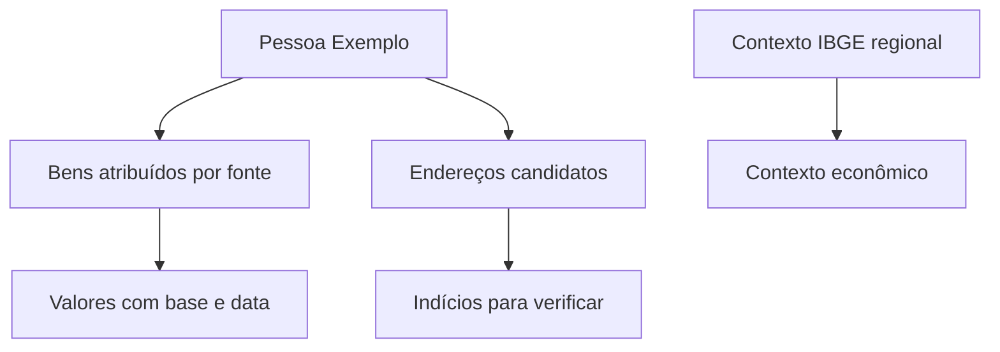

<Note>
**Em breve.** Contrato proposto, ainda indisponível para clientes. Os exemplos são simulações com dados fictícios. Rotas, limites, fontes, cobrança e cobertura dependem de implementação e publicação.
</Note>

O perfil combinado separa `financeira` e `patrimonial` na resposta. Ele pretende reunir sinais patrimoniais e econômicos de um CPF sem misturar patrimônio confirmado com endereços candidatos ou inferência regional. A visão compara bens, referências financeiras e qualidade das fontes para orientar uma investigação.

**Rota proposta:** `POST /inteligencia/perfil/analisar`.

## Entrada proposta

```json
{
  "cpf": "<CPF>",
  "areas": ["financeira", "patrimonial"],
  "incluir": ["imoveis", "escrituras", "veiculos", "enderecos", "beneficios", "empregos", "parentes", "contexto_ibge"]
}
```

O documento é um marcador. Escopo de parentes, profundidade e orçamento devem ser definidos. Um bem de parente não se torna automaticamente patrimônio do alvo.

## Saída proposta

```json
{
  "entidades": [
    {
      "id": "pessoa_1",
      "tipo": "pessoa",
      "nome": "Pessoa Exemplo"
    }
  ],
  "financeira": {
    "renda": {
      "faixa": null,
      "empregos": [],
      "beneficios": [],
      "status": "sem_fontes_suficientes"
    },
    "contexto_ibge": {
      "nivel": "municipio",
      "codigo": "0000000",
      "indicadores": [
        {
          "nome": "rendimento_medio_regional",
          "valor": null,
          "referencia": null,
          "fonte": "IBGE",
          "status": "nao_consultado"
        }
      ],
      "renda_individual_inferida": false
    }
  },
  "patrimonial": {
    "bens_atribuidos": [
      {
        "id": "imovel_1",
        "tipo": "imovel",
        "titular": "pessoa_1",
        "vinculo": {
          "natureza": "propriedade_informada_pela_fonte",
          "evidencias": [
            "evidencia_1"
          ]
        },
        "valores": {
          "venal": {
            "valor": 200000,
            "moeda": "BRL",
            "referencia": "2025",
            "fonte": "Cadastro Fiscal Exemplo"
          },
          "mercado": {
            "faixa": {
              "minimo": 260000,
              "maximo": 330000
            },
            "moeda": "BRL",
            "referencia": "2026-10",
            "fonte": "Comparáveis Exemplo",
            "natureza": "estimativa",
            "incerteza": "alta"
          }
        }
      },
      {
        "id": "veiculo_1",
        "tipo": "veiculo",
        "titular": "pessoa_1",
        "vinculo": {
          "natureza": "proprietario_cadastral",
          "evidencias": [
            "evidencia_2"
          ]
        },
        "valores": {
          "fipe": {
            "valor": 45000,
            "moeda": "BRL",
            "referencia": "2026-10",
            "fonte": "Referência FIPE Exemplo",
            "natureza": "referencia"
          },
          "mercado": null
        }
      }
    ],
    "bens_nao_confirmados": [],
    "enderecos_candidatos": [
      {
        "id": "endereco_1",
        "endereco": "Rua Exemplo, 123, Cidade Exemplo, SP",
        "natureza": "residencia_candidata",
        "propriedade_confirmada": false,
        "aluguel_provavel": null,
        "condominio": null,
        "evidencias": [
          "evidencia_3"
        ]
      }
    ],
    "totais": {
      "atribuido": {
        "valor_venal_imoveis": {
          "valor": 200000,
          "moeda": "BRL",
          "itens": [
            "imovel_1"
          ],
          "referencia": "2025"
        },
        "referencia_fipe_veiculos": {
          "valor": 45000,
          "moeda": "BRL",
          "itens": [
            "veiculo_1"
          ],
          "referencia": "2026-10"
        },
        "mercado_imoveis_estimado": {
          "faixa": {
            "minimo": 260000,
            "maximo": 330000
          },
          "moeda": "BRL",
          "itens": [
            "imovel_1"
          ],
          "referencia": "2026-10"
        }
      },
      "nao_confirmado": null,
      "patrimonio_total": null
    },
    "participacoes": []
  },
  "parentes": [],
  "evidencias": [
    {
      "id": "evidencia_1",
      "fonte": "Registro de Imóvel Exemplo",
      "consultado_em": "2026-10-13T12:00:00Z",
      "descricao": "Fonte informa propriedade."
    },
    {
      "id": "evidencia_2",
      "fonte": "Cadastro Veicular Exemplo",
      "consultado_em": "2026-10-13T12:00:00Z",
      "descricao": "Fonte informa proprietário cadastral."
    },
    {
      "id": "evidencia_3",
      "fonte": "Endereço Cadastral Exemplo",
      "consultado_em": "2026-10-13T12:00:00Z",
      "descricao": "Endereço associado; residência atual não confirmada."
    }
  ],
  "cobertura": [
    {
      "fonte": "Escrituras",
      "status": "nao_consultada"
    },
    {
      "fonte": "IBGE",
      "status": "nao_consultada"
    }
  ],
  "incertezas": [
    "Valores e vínculos simulados para ilustrar o contrato; não há patrimônio total calculado.",
    "Endereço candidato não é bem atribuído nem prova de residência."
  ]
}
```

Os valores são fictícios. Os subtotais apontam para bens existentes no próprio resultado e mantêm bases de avaliação separadas. `patrimonio_total` permanece nulo: somar valor venal, referência FIPE e estimativa de mercado sem uma metodologia comum produziria uma conclusão inadequada.

## Como interpretar

| Categoria | Tratamento proposto |
| --- | --- |
| Imóvel e escritura | Preservar natureza do ato, titularidade, vigência e fonte; escritura não implica automaticamente propriedade atual |
| Endereço associado | Manter como candidato de localização/residência; não atribuir propriedade |
| Valor venal | Referência fiscal com origem e data |
| Valor de mercado | Estimativa com faixa, critérios e incerteza |
| FIPE | Referência de modelo/versão e mês; não preço realizado |
| Aluguel e condomínio | Estimar somente com fontes; manter nulo sem evidência suficiente |
| Emprego e benefício | Dados com fonte e período; sem presumir salário ou renda total |
| Parentes | Relações com evidência; patrimônio individual separado |
| Contexto IBGE | Indicadores regionais com nível e referência; sem inferir renda individual ou classe social pelo bairro |

Uma faixa de renda só deve existir quando fontes sustentarem esse cálculo. Média regional, ocupação, benefício ou aparência do imóvel não autorizam inventar salário individual.

## Exemplo visual



## Uso atual e limites

As consultas atuais de imóveis, escrituras, veículos, benefícios e empregos continuam disponíveis em suas áreas. O agregador, os cruzamentos econômicos, a pesquisa imobiliária e as estimativas descritas aqui são novos contratos propostos. Não há classificação social individual prometida.

## Cobrança e cobertura

Preço, fontes, limites de parentes, regiões e critérios de agregação ainda serão definidos. O resultado deve informar cobertura e ausências por fonte. Um patrimônio total só poderá ser apresentado quando atribuição, datas, valores faltantes, dívida e metodologia forem explicitados; não é uma soma automática dos campos disponíveis.
