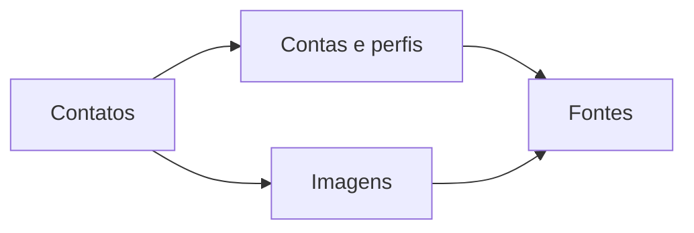

<Note>
**Em breve.** Contrato proposto, ainda indisponível para clientes. Exemplos com dados fictícios. Cobrança, fontes, limites e cobertura serão definidos antes da publicação.
</Note>

Parta de emails e telefones para organizar presenças digitais e imagens com suas origens. O produto pretende reunir resultados sem assumir que todos os identificadores ou perfis pertencem à mesma pessoa.

**Ferramentas propostas:** [contas e registros](/inteligencia/contas), `POST /inteligencia/contas/pesquisar`, e [imagens de perfil](/inteligencia/imagens), `POST /inteligencia/imagens/pesquisar`.

## Entrada proposta

```json
{
  "emails": ["pessoa@example.org"],
  "telefones": ["5511999990000"]
}
```

## Saída proposta: imagens encontradas

```json
{
  "imagens": [{
    "url": "https://example.org/perfil.png",
    "tem_rosto": true,
    "quantidade_rostos": 1,
    "origens": [{"fonte":"Plataforma Exemplo","identificador":"pessoa@example.org","consultado_em":"2026-10-13T12:00:00Z"}]
  }]
}
```

A lista será ordenada e deduplicada, preservando todas as origens. Nenhuma imagem produz lista vazia. Detecção de rosto não confirma identidade; análise indisponível não deve aparecer como zero rostos. As páginas das ferramentas detalham os resultados de contas e fotos separadamente.

## Exemplo visual



## Cobrança e cobertura

Sem tarifa ou lista garantida de plataformas para o novo produto. Hoje [Rastro](/plataforma/rastro) e [Registros](/entidades/registro-digital) têm contratos próprios. A nova pesquisa agregada permanece em breve.
