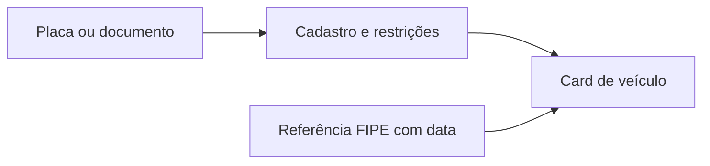

<Note>
**Em breve.** Contrato proposto, ainda indisponível para clientes. Os exemplos são simulações com dados fictícios. Rotas, limites, fontes, cobrança e cobertura dependem de implementação e publicação.
</Note>

O produto pretende reunir veículos e suas restrições, com referências de valor que identifiquem modelo, versão e data. Use essa visão para triagem patrimonial ou validação de informações de um veículo.

**Rota proposta:** `POST /inteligencia/veiculos/pesquisar`.

## Entrada proposta

```json
{
  "placas": ["AAA0A00"],
  "documentos": [{"tipo":"CPF","valor":"<CPF>"}],
  "incluir": ["cadastro", "restricoes", "fipe"]
}
```

Placa e documento são exemplos fictícios ou marcadores. Limites de lote e deduplicação entre placa e proprietário ainda serão definidos.

## Saída proposta

```json
{
  "veiculos": [{
    "id": "veiculo_1",
    "placa": "AAA0A00",
    "modelo": "Modelo Exemplo",
    "ano_modelo": 2022,
    "proprietario": {"entidade_id":"pessoa_1","vinculo":"cadastro","fonte":"Fonte Cadastral Exemplo"},
    "restricoes": [],
    "valores": {
      "fipe": {"valor":45000,"moeda":"BRL","codigo":"000000-0","referencia":"2026-10","modelo":"Modelo Exemplo","correspondencia":"aproximada","fonte":"Referência FIPE Exemplo"},
      "mercado": null,
      "leilao": null
    },
    "consultado_em": "2026-10-13T12:00:00Z"
  }],
  "entidades": [{"id":"pessoa_1","tipo":"pessoa","nome":"Pessoa Exemplo"}],
  "incertezas": ["Valor fictício; a versão exige confirmação antes de usar a referência."]
}
```

Uma referência FIPE não é preço de venda confirmado. Valor de mercado e de leilão são categorias separadas e podem permanecer nulos. O proprietário cadastral não comprova posse atual ou localização física.

## Exemplo visual



## Uso atual e limites

Hoje existem as consultas `GET /veiculos/cpf/{cpf}`, `GET /veiculos/cnpj/{cnpj}` e `GET /veiculos/placa/{placa}`. O [schema Veículo](/entidades/veiculo) inclui `media_preco`, que pode estar vazio. Isso não implementa a pesquisa FIPE por versão nem o contrato agregado proposto.

## Cobrança e cobertura

O novo produto não tem tarifa definida. Cobertura depende de cadastro, correspondência da versão e referência disponível. A ausência de restrição na consulta não deve ser vendida como garantia universal sobre o veículo.
